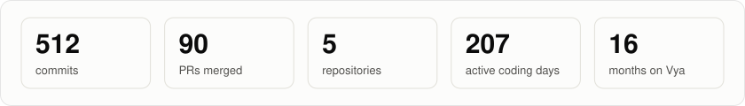
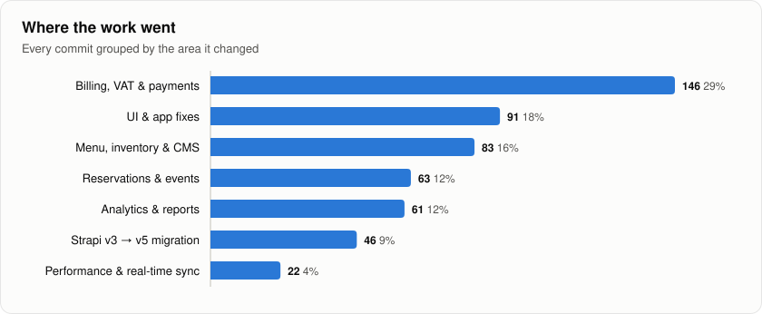

<h1 align="center">Hi, I'm Bilgates 👋</h1>

  Full-stack developer at <b>Xorstack</b>, building <b>Vya</b>: a restaurant booking, ordering and payments platform.

  
  
  
  
  
  

<picture>
  <source media="(prefers-color-scheme: dark)" srcset="assets/stats-dark.svg">
  
</picture>

<picture>
  <source media="(prefers-color-scheme: dark)" srcset="assets/activity-dark.svg">
  
</picture>

<picture>
  <source media="(prefers-color-scheme: dark)" srcset="assets/focus-dark.svg">
  
</picture>

## What I work on

- 🧾 **Billing & VAT:** bills that add up exactly, including splits, comps, coupons and tips
- 📊 **Analytics:** sales, seating and waiter performance dashboards
- 🍽️ **Restaurant CMS:** menus, inventory, reviews, ads and coupons
- 📅 **Reservations:** bookings, seat capacity and real-time sync between apps
- 🔁 **Strapi v3 → v5:** migrating the backend without breaking the apps
