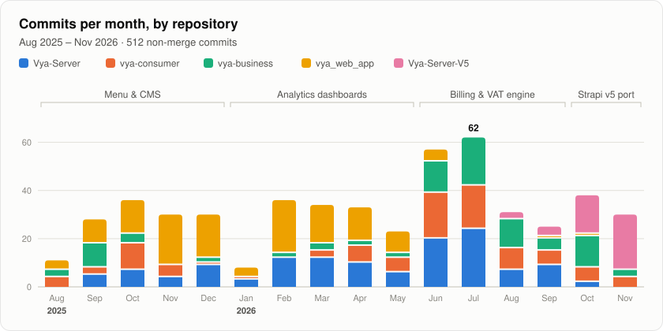

<h1 align="center">Hi, I'm Bilgates 👋</h1>

  Full-stack developer at <b>Xorstack</b>, working on <b>Vya</b>: a restaurant booking, ordering and payments platform. 
  I work across the whole product: the Strapi backend, both React Native apps and the Next.js restaurant CMS.

  
  
  
  
  
  
  
  
  

<picture>
  <source media="(prefers-color-scheme: dark)" srcset="assets/stats-dark.svg">
  
</picture>

## Activity

<picture>
  <source media="(prefers-color-scheme: dark)" srcset="assets/activity-dark.svg">
  
</picture>

Monthly numbers

| Month | Vya-Server | vya-consumer | vya-business | vya_web_app | Vya-Server-V5 | Total |
|---|--:|--:|--:|--:|--:|--:|
| Aug 2025 | 0 | 4 | 3 | 4 | – | 11 |
| Sep 2025 | 5 | 3 | 10 | 10 | – | 28 |
| Oct 2025 | 7 | 11 | 4 | 14 | – | 36 |
| Nov 2025 | 4 | 5 | 0 | 21 | – | 30 |
| Dec 2025 | 9 | 1 | 2 | 18 | – | 30 |
| Jan 2026 | 3 | 1 | 0 | 4 | – | 8 |
| Feb 2026 | 12 | 0 | 2 | 22 | – | 36 |
| Mar 2026 | 12 | 3 | 3 | 16 | – | 34 |
| Apr 2026 | 10 | 7 | 2 | 14 | – | 33 |
| May 2026 | 6 | 6 | 2 | 9 | – | 23 |
| Jun 2026 | 20 | 19 | 13 | 5 | – | 57 |
| Jul 2026 | 24 | 18 | 20 | 0 | – | 62 |
| Aug 2026 | 7 | 9 | 12 | 0 | 3 | 31 |
| Sep 2026 | 9 | 6 | 5 | 1 | 4 | 25 |
| Oct 2026 | 2 | 6 | 13 | 1 | 16 | 38 |
| Nov 2026 | 0 | 4 | 3 | 0 | 23 | 30 |

## Repositories

| Repository | Stack | Commits | My part |
|---|---|--:|---|
| **vya_web_app** | Next.js 14 · TypeScript | 139 | Restaurant CMS: menu and item review flow, sales analytics, ads, coupons, back office |
| **Vya-Server** | Strapi v3 · MongoDB · Socket.IO | 130 | Billing and VAT engine, reservations, reporting APIs, sockets, Stripe |
| **vya-consumer** | React Native | 103 | Diner app: booking, wallet, cart, payment sheet, invoices and PDF sharing |
| **vya-business** | React Native · TypeScript | 94 | Staff app: kitchen and waiter flow, events, payment details, invoice modal, coupons |
| **Vya-Server-V5** | Strapi v5 · Redis | 46 | Porting the backend from Strapi v3 to v5 while keeping every client working |

Plus **90 merged pull requests** across the same repos.

## Where the work went

<picture>
  <source media="(prefers-color-scheme: dark)" srcset="assets/focus-dark.svg">
  
</picture>

## What I've built

### 🧾 Billing & VAT engine · Jun – Sep 2026
*Vya-Server, vya-consumer, vya-business*

- Server-side VAT across the 3%, 14% and 17% brackets, with full-precision buckets and an untaxed lane for variant prices
- Correct totals for comped items, split shares, coupons and end-of-bill discounts, in every combination
- Split bills that keep the whole-bill total exact, using grand-total reconciliation to absorb rounding cents
- Tips credited only to the payer, partial voids that subtract the right amount, and food vouchers shown as one line
- Waiter-applied coupons that rescale VAT, notify the diner by push and reset cleanly on re-checkout
- Invoice and payment screens in both apps matched to the server, so the bill shown is the amount charged

### 📊 Analytics dashboards · Jan – May 2026
*vya_web_app, Vya-Server*

- Net and gross sales reports, with comps counted in gross and excluded from net, and VAT-inclusive or exclusive views
- Checks, reservations and seating reports with weather data and table vs pre-order channel filters
- Activity heatmap built on waiter shift tracking
- Waiter sales and hourly performance dashboards with KPIs and period comparisons
- Upsell reporting and a per-waiter turn-time report
- PNG export for graphs and a timezone fix across every sales tab

### 🍽️ Restaurant CMS · Aug – Dec 2025, then ongoing
*vya_web_app, Vya-Server*

- Menu item submission and review flow: drafts, review, rejected categories, and hiding items until approved
- Item availability and business-hours validation, exceptional opening and closing days
- Inventory that carries forward until stock hits zero, plus unlimited-stock items
- Reviews page, with images auto-removed after reports from 10 different users
- Submissions with pagination and SKU search, and compulsory vs optional categories
- Later: modifier linked items, an ad approval page with analytics and moderation history, a transactions page, coupon management with "Buy for Points", and AI image generation in the CMS

### 📅 Reservations & real-time sync
*all repos*

- Pending reservations that auto-confirm as their start time approaches, plus edit-reservation and edit-event flows
- Seat capacity that counts pending invites and cancellations, so tables can't be overbooked
- Automatic expiry for seated no-shows
- Both apps moved off the device clock onto server time for bookings, kitchen, history and invoices
- Role checks on socket connections, plus live sync of tables, waiter/kitchen accounts and the same item ordered from different apps

### 🔁 Strapi v3 → v5 migration · Aug – Nov 2026
*Vya-Server-V5*

- Ported the consumer, product, kitchen and socket APIs from Strapi v3 to v5
- Wrote compatibility layers so the existing mobile apps work unchanged: v3 error shapes, v3 line-data shapes and relation-ID normalisation
- Moved caching onto Redis
- Re-ported the latest v3 fixes into v5 as they landed, including guest resolution, OTP channels, no-show expiry and server time

### ⚡ Performance
- Cut the wallet payload from about 22 MB to under 1 MB by sending only the fields the app uses
- Faster home feed filters, profile saves via `updateOne`, and quicker first loads for history and submissions

## How I work

- One branch per ticket, a PR for every change, and `[FIX]` / `[FEATURE]` commit prefixes
- API, socket and schema changes are checked against all three clients before they ship
- Bugs are reproduced on real data locally and verified on a fresh order before closing

Charts are generated from my git history across the five Vya repositories (Aug 2025 – Nov 2026).

